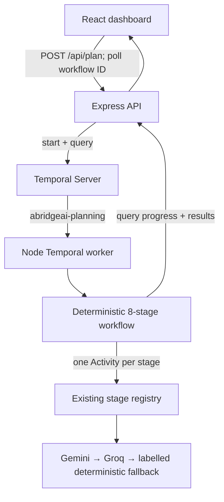

# AbridgeAI

> **From "I have an idea" to "I know exactly what to build."**

AbridgeAI is a standalone AI-powered project planning and feasibility studio that turns rough ideas into structured, build-ready project plans. A Node.js/Express **backend** starts durable Temporal workflows; a separate Node.js worker runs the existing eight-stage planning pipeline and a React frontend displays workflow progress and results.

---

## Screenshots

| Overview — light theme | Planning run — dark theme |
|:---:|:---:|
|  |  |
| Dashboard with metrics, project history, and the live pipeline timeline. | A completed planning run with the 8-stage pipeline and feasibility score. |

| Builder profile — dark theme | Research stage — dark theme |
|:---:|:---:|
|  |  |
| Builder profile built from public GitHub language signals. | Opportunity, risk, and direction scan for the idea as written. |

| Starter scaffold — light theme |
|:---:|
|  |
| Generated starter project with file tree, README and PLAN.md — downloadable as a .zip. |

## What is AbridgeAI?

Developers often start with an idea without knowing:

- whether it is actually feasible to build
- how much to build for an MVP
- what technology stack fits their skills and timeline
- how to structure the implementation
- what to build first

AbridgeAI answers all of these questions by running a deterministic planning pipeline on your project inputs.

---

## The Workflow

```
Rough Project Idea
        ↓
Builder Profile (GitHub Signals)
        ↓
Research & Opportunity Analysis
        ↓
Feasibility Assessment
        ↓
Architecture Direction
        ↓
Tech Stack Recommendation
        ↓
Builder Plan & Starter Scaffold
        ↓
Complete Project Brief (exportable .md)
```

---

## Features

- **8-stage planning pipeline** — existing backend stage registry (incl. the Deep Dive) executed as durable Temporal Activities, with an in-process job runner fallback when Temporal is unavailable
- **Backend API** — Express starts workflows (`POST /api/plan`), reports durable progress/results (`GET /api/workflows/:workflowId`), and serves metadata and exports
- **Stage metadata endpoint** — stage names, order, and hints come from `GET /api/meta`, so the UI timeline never drifts from the backend
- **Feasibility scoring** — a /100 score across five weighted axes (idea clarity, stack fit, scope, time realism, builder fit) with a GO / Proceed with caution / Rethink verdict
- **Builder profile** — personalizes recommendations based on public GitHub language signals
- **Custom stack support** — enter any combination (e.g. `FastAPI + React + PostgreSQL`, or `cpp + python`); it's parsed into per-component layers, a matching starter base is chosen, and the scaffold README lists the exact toolchain (e.g. a C++/CMake note) each planned component needs
- **Deadline-aware milestone plans** — plans are sized to your window: deadlines of ≤ 14 days produce Day-based milestones (Day 1 / Day 3 / Day 5…) and an effort estimate framed around that deadline, instead of always assuming weeks
- **Provider-resilient LLM stages** — each LLM stage shows a badge for where its content came from: `Gemini · live`, `Groq · live`, `LLM · cached`, or `fallback`
- **Architecture blueprint** — module breakdown and data-flow pattern
- **Tech stack recommendation** — matched to your comfort level and project type
- **Starter scaffold** — downloadable as a `.zip` with a project-specific `README.md` (idea, why, architecture diagram, stack rationale, dependencies, quick start) and a `PLAN.md` (feasibility summary and implementation milestones)
- **Markdown export** — full project brief downloadable as `.md`
- **LLM-Enhanced Research** — research, architecture, builder, and brief stages are boosted with idea-specific content from Gemini (`GEMINI_API_KEY`), backed up by Groq (`GROQ_API_KEY`) with automatic fallback, cached results, and live provider badges; the app always works even with no keys set.
- **Project history** — saved to localStorage, restorable, deletable
- **Draft autosave** — form persists across reloads
- **Light & dark themes** — respects system preference, stored across sessions
- **Accessible** — keyboard navigable, ARIA labels, reduced-motion support

---

## Architecture

The Express API starts a Temporal workflow and returns its ID immediately. A separate worker polls the configured task queue and executes each existing planning stage as a Temporal Activity. The workflow records progress and exposes it through a query used by the API and frontend.



```
AbridgeAI/
├── backend/                      # ALL planning logic lives here
│   ├── server.js                 # entry: createApp().listen(3001)
│   ├── worker.js                 # long-running Temporal worker process
│   ├── app.js                    # Express app factory (API + static) — shared with local server & Vercel
│   ├── src/
│   │   ├── temporal/             # workflow, activities, client and configuration
│   │   ├── pipeline/
│   │   │   ├── stages.js         # Single source of truth for the 7 stages
│   │   │   ├── context.js        # Typed pipeline context { input, results, errors }
│   │   │   └── runPipeline.js    # Generic loop over the stage registry
│   │   ├── agents/               # 7 stage functions (run(ctx) → structured outputs)
│   │   │   ├── githubAgent.js
│   │   │   ├── researchAgent.js  # Gemini-first → Groq → deterministic fallback
│   │   │   ├── feasibilityAgent.js
│   │   │   ├── architectureAgent.js
│   │   │   ├── techStackAgent.js
│   │   │   ├── builderAgent.js
│   │   │   └── briefAgent.js     # thin wrapper over brief/model + render
│   │   ├── brief/
│   │   │   ├── model.js          # Canonical brief model (single source)
│   │   │   └── render.js         # renderText() + renderMarkdown()
│   │   ├── domain/               # STACKS, PROJECT_TYPES, TEAM_SIZES, deadlines, custom-stack parsing
│   │   │   ├── stacks.js
│   │   │   ├── types.js
│   │   │   ├── deadline.js
│   │   │   └── techs.js          # customStackTokenizer + component → language map
│   │   ├── prompts/prompts.js    # LLM instruction prompts (stack-as-constraint, deadline-sizing)
│   │   ├── scaffold/             # Starter generators + file tree
│   │   ├── services/
│   │   │   ├── github.js         # GitHub API fetch + sample fallback
│   │   │   ├── llm.js            # LLM orchestrator: Gemini → Groq → deterministic
│   │   │   ├── gemini.js         # Gemini client with bounded request timeout
│   │   │   ├── groq.js           # Groq client with bounded request timeout
│   │   │   ├── jarvislabs.js         # Jarvislabs Token Factory client (Stage 8 + chain)
│   │   │   └── utils/fetchTimeout.js # Shared timeouts: LLM 20s, GitHub 10s
│   │   ├── utils/hash.js         # Deterministic hash + seeded pick
│   │   └── export/markdown.js    # Markdown brief builder (legacy-safe)
│   └── package.json              # Express and Temporal SDK dependencies
│
├── src/                          # Frontend (React + Vite)
│   ├── api/client.js             # Fetch wrappers → /api/meta, /api/plan, /api/workflows/:id, /api/jobs, /api/export
│   ├── components/               # React UI (Header, Pipeline, Cards, Form, …)
│   ├── utils/
│   │   ├── storage.js            # localStorage: history, draft, theme, workflow ID
│   │   ├── export.js             # downloadFile helper
│   │   └── zip.js                # fflate ZIP for the scaffold download
│   ├── App.jsx                   # State + calls backend + view routing
│   ├── main.jsx
│   └── index.css
│
├── api/index.js                  # Vercel serverless entrypoint → createApp()
├── public/data/                  # sample-github-analysis.json (read by backend)
├── vite.config.js                # dev proxy: /api → localhost:3001
├── .env                          # local Temporal settings and optional provider keys (see .env.example)
└── package.json
```

### API endpoints

| Method | Path             | Purpose                                                    |
|--------|------------------|------------------------------------------------------------|
| GET    | `/api/health`    | Health check                                              |
| POST   | `/api/jobs`      | In-process pipeline run (Temporal fallback) → `{ job: { id, stages } }` |
| GET    | `/api/jobs/:id`  | Poll in-process job: statuses, results, errors            |
| GET    | `/api/meta`      | Stage/domain metadata — drives the timeline + form dropdowns |
| POST   | `/api/plan`      | Start a workflow → HTTP 202 `{ workflowId, status }`      |
| GET    | `/api/workflows/:workflowId` | Retrieve workflow status, stage progress, errors, and available results |
| POST   | `/api/export`    | Render a saved record → `{ filename, markdown }`          |

---

## Running Locally

You need a Temporal development server, the **API**, the separate **worker**, and the **frontend**. The Temporal CLI runs its local server without Docker and includes the Web UI.

### 1. Install prerequisites and dependencies

Install Node.js 22+ and the [Temporal CLI](https://docs.temporal.io/cli/setup-cli). On Windows, download and extract the `windows/amd64` or `windows/arm64` CLI archive and add `temporal.exe` to `PATH`. Then, in PowerShell:

```powershell
npm install
Push-Location backend
npm install
Pop-Location
if (-not (Test-Path .env)) { Copy-Item .env.example .env }
```

Temporal settings have local defaults. Set `TEMPORAL_ADDRESS`, `TEMPORAL_NAMESPACE`, and `TEMPORAL_TASK_QUEUE` in `.env` only if your server uses different values. For Temporal Cloud, also set `TEMPORAL_TLS=true` and `TEMPORAL_API_KEY`. The setup command preserves an existing `.env`; add only missing variables rather than replacing your configuration. Provider keys are optional; without them, the existing deterministic fallback is used.

Each stage Activity has a 3-minute start-to-close timeout, 7-minute schedule-to-close timeout, and at most 2 attempts. The full workflow has a 60-minute execution timeout. Outbound LLM and GitHub HTTP requests time out after `LLM_TIMEOUT_MS` (20s) and `GITHUB_TIMEOUT_MS` (10s).

### 2. Start Temporal

For a restart-persistent local history database, run this in the first terminal:

```powershell
New-Item -ItemType Directory -Force "$env:LOCALAPPDATA\AbridgeAI" | Out-Null
temporal server start-dev --ip 127.0.0.1 --db-filename "$env:LOCALAPPDATA\AbridgeAI\temporal.db"
```

The service listens on `localhost:7233`, creates the `default` namespace, and serves the Web UI at `http://localhost:8233`. Keep this terminal running.

### 3. Start the API and worker

In two additional terminals from the repository root:

```powershell
npm run server
```

```powershell
npm run worker
```

Both processes read `.env`. The worker logs the address, namespace, and task queue it connected to. In local development, `npm run temporal:dev` also starts an ephemeral Temporal development server (without the persistent database option above).

### 4. Start the frontend

In another terminal:

```powershell
npm run dev
```

Open `http://localhost:5173`. Vite forwards API requests to the backend on port 3001. The frontend stores the latest workflow ID and input in localStorage and reconnects to that workflow after refresh.

If port 3001 is occupied, run the API on another port and point Vite at it:

```powershell
$env:PORT = "3002"
npm run server
```

In a separate terminal:

```powershell
$env:ABRIDGEAI_API_PROXY = "http://localhost:3002"
npm run dev -- --host 127.0.0.1 --port 5174
```

For production static serving, build the frontend and launch the API as usual:

```powershell
npm run build
npm run start
```

The Temporal service and worker must still be running separately.

### Verify a real workflow

After the Temporal server, API, and worker are running, submit a low-cost request with provider keys unset (the existing fallback is used). In PowerShell:

```powershell
$body = @{
  idea = "Build a simple task management web application."
  name = "Temporal demo"
  stack = "typescript"
  github = ""
  comfort = "beginner"
  type = "web-app"
  team = "solo"
  deadline = "2 weeks"
  audience = "small teams"
} | ConvertTo-Json
$started = Invoke-RestMethod -Method Post -Uri http://localhost:3001/api/plan -ContentType "application/json" -Body $body
$started
Invoke-RestMethod -Uri "http://localhost:3001/api/workflows/$($started.workflowId)"
```

The first response should contain a workflow ID and `running`; the second endpoint returns the workflow status, per-stage progress, errors, and results. Confirm activity execution and history in the Web UI at `http://localhost:8233`. Refreshing the frontend should reconnect to the saved workflow ID.

### Checks and tests

```powershell
npm run lint
npm run build
npm run test:backend
```

Backend tests use Temporal's local test environment; they may download the Temporal test server on first run. They do not invoke Gemini, Groq, or GitHub.

---

## Deploying to Vercel

The Express API can run as a Vercel serverless function and start workflows on a reachable Temporal service. The Temporal worker itself must be deployed as a separate, long-running process (for example, a container or VM); Vercel functions cannot replace that worker.

- **Frontend** — Vercel runs `npm run build` (Vite) and serves `dist/`.
- **Backend** — `api/index.js` exports the same Express app (`backend/app.js`)
  as a serverless function. Every `/api/*` request is rewritten to it, and all
  other routes fall back to the SPA's `index.html` (`vercel.json`).
- The API and worker must both be configured to use the same Temporal address,
  namespace, and task queue. Deploy the worker with provider API keys; keep
  them out of the browser and Vercel client bundle.

### Setting environment variables

Set these in **Vercel → Project → Settings → Environment Variables** (never
commit `.env` — it's gitignored):

| Variable           | Required? | Example                          |
|--------------------|-----------|----------------------------------|
| `GEMINI_API_KEY`   | optional  | `AIza…` (from aistudio.google.com) |
| `GEMINI_MODEL`     | optional  | `gemini-3.6-flash`               |
| `GROQ_API_KEY`     | optional  | `gsk_…` (from console.groq.com)  |
| `GROQ_MODEL`       | optional  | `openai/gpt-oss-120b`            |
| `TEMPORAL_ADDRESS` | optional locally; required for remote service | Temporal gRPC address |
| `TEMPORAL_NAMESPACE` | optional locally; required for remote service | `default` locally |
| `TEMPORAL_TASK_QUEUE` | optional locally; must match worker | `abridgeai-planning` locally |
| `TEMPORAL_TLS` | optional | `true` for TLS endpoints |
| `TEMPORAL_API_KEY` | optional | API key for Temporal Cloud; server/worker only |
| `LLM_TIMEOUT_MS` / `GITHUB_TIMEOUT_MS` | optional | `20000` / `10000` |

Without a key the app runs fully deterministically (every badge shows
`fallback`). A Temporal service and a compatible worker are still required to
start and execute planning workflows.

### Deploy steps

```bash
npx vercel          # link + preview deploy
npx vercel --prod   # production deploy
```

Or import the repo at https://vercel.com/new — framework preset "Vite" is
detected automatically and no extra build settings are required.

> `PORT` is handled by Vercel (or defaults to 3001 locally).

---

## LLM-Enhanced Research

The **Research**, **Architecture**, **Builder**, and **Brief** stages are boosted
with idea-specific content from Google's Gemini when a key is configured. If
Gemini is missing, unparsable, or out of quota (the free tier allows ~20
requests/day on `gemini-3.6-flash`), the fallback provider **Groq** (an
OpenAI-compatible endpoint on fast inference hardware) steps in; if that also
fails, the stage falls back to the deterministic agents. Every other stage
stays deterministic.

**To enable it:**

1. Get a Gemini key at https://aistudio.google.com (primary).
2. Get a Groq key at https://console.groq.com (fallback — helps when Gemini hits its daily quota).
3. `copy .env.example .env` and set `GEMINI_API_KEY=...` (and `GROQ_API_KEY=...`).
4. Restart the API and worker (`npm run server`, `npm run worker`)

- Prompts live in `backend/src/prompts/prompts.js` — each defines the strict
  JSON shape the stage expects, so output is concrete and idea-specific.
- Results are cached per project-input hash in the worker process, so repeats
  handled by that process may reuse results (`cached-llm` badge).
- No key, network failure, or API error = automatic fallback to the bundled
  deterministic agents (shown as `fallback` in the UI). The app always works.
- Each Activity has a bounded retry policy and provider/GitHub requests have an
  explicit timeout. A worker failure after a provider accepted a request but
  before Temporal recorded the Activity result can cause that external request
  to be repeated; the retry limit bounds, but cannot eliminate, that possibility.

---

## GitHub Privacy

AbridgeAI only uses **public** GitHub information via the unauthenticated GitHub API:

```
https://api.github.com/users/{username}
https://api.github.com/users/{username}/repos?per_page=100&sort=updated
```

- No OAuth, no tokens, no private repositories, no authentication
- The API is rate-limited at 60 requests/hour/IP for unauthenticated use (enforced on the backend, not the browser)
- If GitHub is unavailable, rate-limited, or the username doesn't exist, the pipeline gracefully falls back to bundled sample data and labels the card accordingly
- GitHub analysis is optional — leave the username blank to skip it

---

## Local Storage

AbridgeAI uses `localStorage` for:

| Key | Purpose |
|---|---|
| `abridgeai.history.v1` | Saved project runs (up to 12) |
| `abridgeai.draft.v1` | Form draft autosave |
| `abridgeai.theme.v1` | Light/dark theme preference |

Clearing browser data for the site resets everything.

---

## Limitations

- **Feature depth, not production-grade** — the generated scaffold is a starting point that needs real implementation, and the feasibility score is a planning heuristic, not a scientific measurement.
- **GitHub signal is directional** — the builder profile uses public-repo language tallies as a rough guide, not a skill assessment.
- **LLM content depends on the provider** — add `GEMINI_API_KEY` / `GROQ_API_KEY` for idea-specific text; without keys the app still runs fully deterministic.

---

## Team — AbridgeAI

- [Suzanne Daniel Thomas](https://github.com/suzannet-menon)
- [Ishwari Tapkir](https://github.com/ishwaritapkir)
- [hereisgautam](https://github.com/hereisgautam)
- [Sumitrathod16](https://github.com/Sumitrathod16)

## License

Licensed under the [Apache License, Version 2.0](LICENSE).
